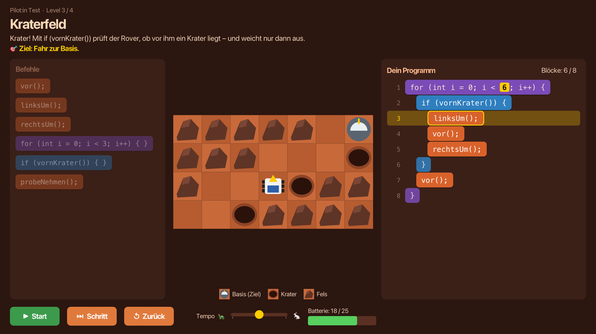
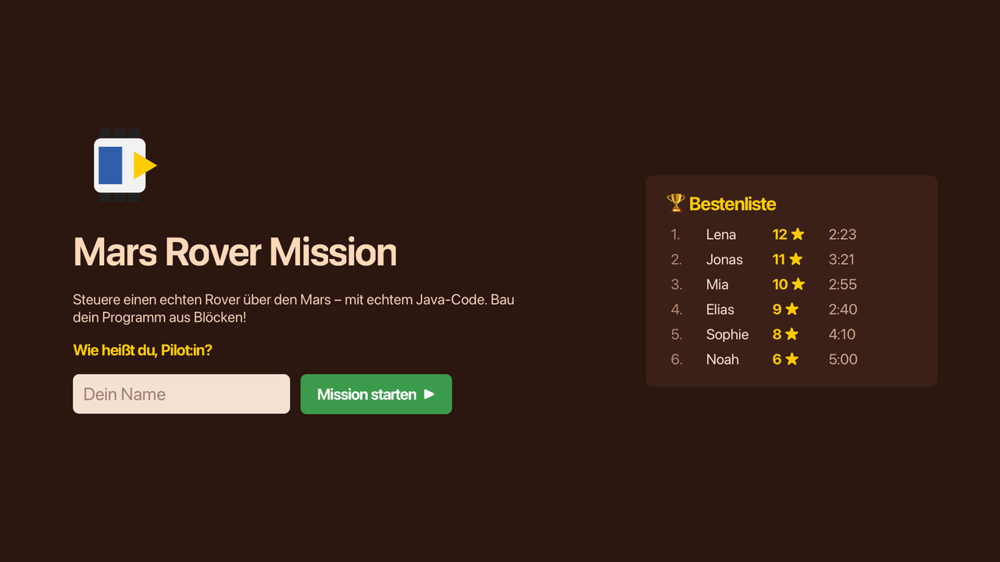
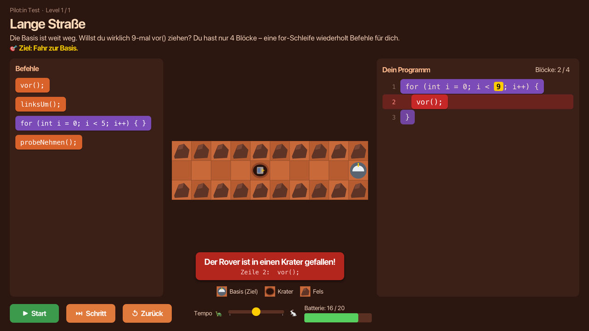
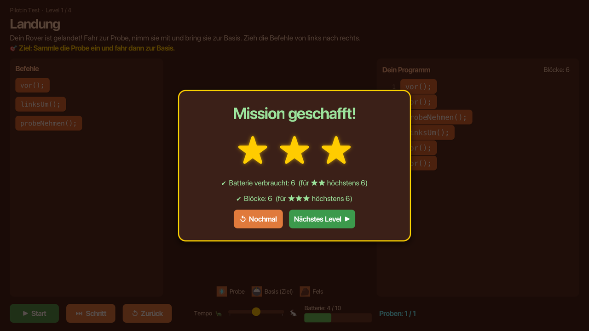
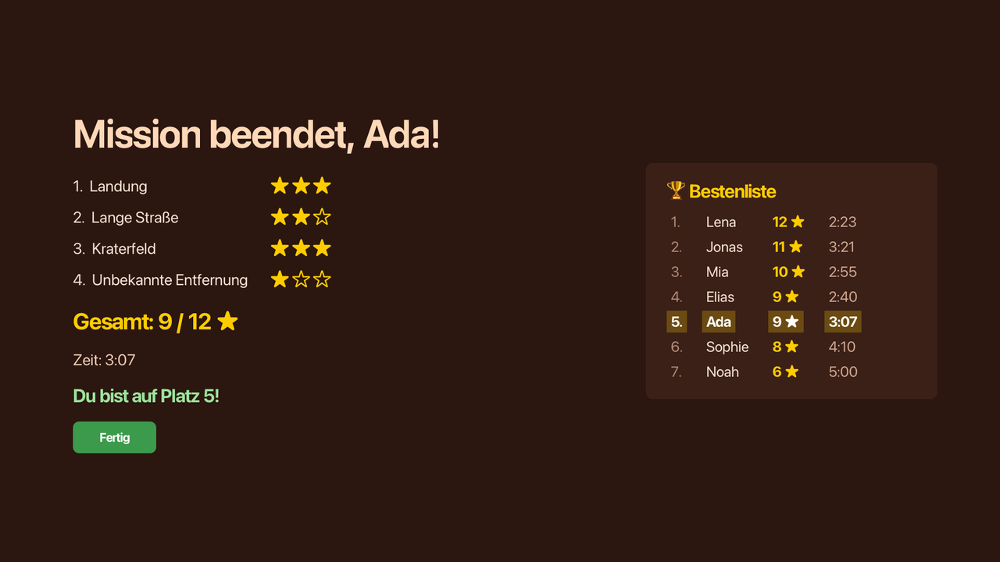

# 🚀 Mars Rover Mission

A puzzle game for the **HTL open day (Tag der offenen Tür), IT department**.
Visitors aged about 13–14 steer a Mars rover by arranging **real Java code blocks** with the mouse.
It is a Parsons puzzle loosely based on the Java Hamster model.



> **Status:** feature-complete for the open day on **Friday, 13 November 2026**.
> Please try it **before Thursday** and report anything odd (see [Testing & feedback](#-testing--feedback)).

---

## Contents

- [What it is](#-what-it-is)
- [Screenshots](#-screenshots)
- [Quick start (for testers)](#-quick-start-for-testers)
- [How to play](#-how-to-play)
- [The default levels](#-the-default-levels)
- [Writing your own levels](#-writing-your-own-levels)
- [Running it on the open day (kiosk PC)](#-running-it-on-the-open-day-kiosk-pc)
- [Testing & feedback](#-testing--feedback)
- [For developers](#-for-developers)
- [Scope](#-scope)
- [Documentation](#-documentation)
- [License](#-license)

---

## 🪐 What it is

- **Goal:** a visitor solves the first level in about **one minute without any explanation**.
  A whole session (four levels) takes **3–5 minutes**.
- **Real Java:** what the visitor builds is valid, indented Java, shown with line numbers.
  While the program runs, the current line is highlighted, so code and effect appear side by side.
- **No compiler involved:** blocks become a small syntax tree, which the game's own interpreter runs
  step by step. This makes it safe, pausable and protected against endless loops.
- **Kiosk-ready:**
  - full screen that visitors can't leave
  - name entry and a leaderboard
  - auto-reset after 60 s of inactivity
  - a hidden admin panel
- **Extendable on the day:** students can drop new level files (JSON) into a folder and reload them
  without restarting.

All texts that visitors see are **German**; code, comments and developer docs are English.

## 📸 Screenshots

| Start screen with leaderboard | Building and running a program |
|---|---|
|  |  |
| **Friendly error with the Java line** | **Level solved: stars** |
|  |  |
| **End of the session** | |
|  | |

The level 3 screenshot shows its solution, so skip it if you want to solve the level yourself.

## ⚡ Quick start (for testers)

**You need:** [JDK 25](https://adoptium.net/) (or newer) and [Maven 3.9+](https://maven.apache.org/).
Check with `java -version` and `mvn -version`.

```bash
git clone <this repository>
cd mars-rover
mvn -q package                                  # builds and runs all tests (~1 min the first time)
java -Dkiosk=false -jar target/mars-rover.jar   # play in a normal window
```

> ⚠️ **Without `-Dkiosk=false` the game starts in locked kiosk mode.** Esc and Alt+F4 won't close it.
> To get out: press **Ctrl + Shift + A**, enter the PIN (default `1234`), then click **Programm beenden**.
> On a Mac that is the Control key, not Cmd.

Shortcuts for testing:

```bash
java -Dkiosk=false -Dlevel=3 -jar target/mars-rover.jar                 # jump straight to level 3
java -Dkiosk=false -Dlevel=2 -Ddemo=true -jar target/mars-rover.jar     # level 2 with its solution loaded
```

Run it from the project folder: the game reads `levels/` and `data/` from the current directory.

## 🎮 How to play

1. Type your name and press **Mission starten**.
2. Read the **goal** under the level title, e.g. *"Ziel: Sammle die Probe ein und fahr dann zur Basis."*
3. Build a program from the blocks on the left (**Befehle**) in the program area on the right (**Dein Programm**).
4. Press **Start** and watch the rover. The line being executed lights up.
5. Solved? You get 1–3 stars. Try again for more, or move on to the next level.

A level is won when, **at the end of the program**, all samples are collected and the rover is on the base.

### Mouse

| Action | How |
|---|---|
| Add a block | Drag it from the palette into the program; a yellow line shows where it lands. Or click it to add it at the end. |
| Move a block | Drag it. Loops and `if` blocks move together with everything inside them. |
| Put a block **inside** a loop | Drop it **above** the loop's closing `}`. Drop it below `}` to put it after the loop. |
| Delete a block | Right-click it, or drag it back onto the palette. |
| Change a `for` count | Click the yellow number: left click +1, right click −1, or use the scroll wheel (1–20). |

### Keyboard

| Key | Action |
|---|---|
| `F5` / `Enter` | Run |
| `F6` | One step |
| `R` | Reset rover (the program stays) |
| `Del` / `Backspace` | Delete the selected block (click a block to select it) |

### The rover's Java API

| Call | Kind | Effect |
|---|---|---|
| `vor();` | action | one tile forward (dust costs 2 battery) |
| `linksUm();` / `rechtsUm();` | action | turn 90° left / right |
| `probeNehmen();` | action | collect the sample on the current tile |
| `vornFrei()` | sensor | `true` if the tile ahead is drivable (no rock, no crater, not the map edge) |
| `vornKrater()` | sensor | `true` if a crater is ahead |
| `probeDa()` | sensor | `true` if a sample is on the current tile |
| `amZiel()` | sensor | `true` if the rover is on the base |

Control blocks: `for (int i = 0; i < N; i++) { }`, `while (…) { }`, `if (…) { }`, `if (…) { } else { }`.
Every action costs 1 battery, and sensors are free.

### Map tiles

| Tile | Meaning |
|---|---|
| Ground | drivable |
| Rock | blocks the rover: driving into it ends the run |
| Crater | the rover falls in: run over |
| Sample (cyan crystal) | collect it with `probeNehmen()` |
| Base (dome) | the goal |
| Dust (light, dotted) | drivable, but costs 2 battery |

A legend under the map shows the tiles of the current level.

### Stars

| Stars | Condition |
|---|---|
| ★ | solved |
| ★★ | and used at most the level's battery target |
| ★★★ | and used at most the level's block target |

The leaderboard ranks by **total stars**, then by **time** (start of session until the last solved level).

### Error messages

Instead of stack traces, visitors get a red banner with a short German explanation plus the Java line, e.g.
**"Der Rover ist in einen Krater gefallen!"** – `Zeile 2: vor();`.
Other messages cover rocks, an empty battery, a missing sample, an endless loop (after 1000 steps),
samples left over, and not ending on the base.

## 🗺️ The default levels

| # | Title | Teaches | Twist |
|---|---|---|---|
| 1 | **Landung** | sequence | only 3 block types |
| 2 | **Lange Straße** | `for` loop | only 4 blocks allowed for a 9-tile road |
| 3 | **Kraterfeld** | `for` + `if (vornKrater())` | a staircase of craters, 8-block limit |
| 4 | **Unbekannte Entfernung** | `while (vornFrei())` | no `for` in the palette |

<details>
<summary>Spoiler: reference solutions (each gives 3 stars)</summary>

```java
// 1 Landung
vor(); vor(); probeNehmen(); linksUm(); vor(); vor();

// 2 Lange Straße
for (int i = 0; i < 9; i++) { vor(); }

// 3 Kraterfeld
for (int i = 0; i < 6; i++) {
    if (vornKrater()) { linksUm(); vor(); rechtsUm(); }
    vor();
}

// 4 Unbekannte Entfernung
while (vornFrei()) { vor(); }
probeNehmen();
rechtsUm();
while (vornFrei()) { vor(); }
```

These solutions are also unit tests (`DefaultLevelsTest`). If anyone edits a default level and breaks it,
the build fails.
</details>

## 🧩 Writing your own levels

Levels are JSON files in `levels/`, played in filename order. A minimal example:

```json
{
  "id": "05-spirale",
  "title": "Spirale",
  "intro": "Ein kurzer Satz, der neugierig macht.",
  "width": 6, "height": 4,
  "tiles": ["RRRRRR", "GGSGGB", "GCGGRG", "GGGGGG"],
  "rover": { "x": 0, "y": 1, "dir": "E" },
  "battery": 20,
  "palette": ["vor", "linksUm", "rechtsUm", "probeNehmen", "for:3", "if:vornKrater"],
  "maxBlocks": 8,
  "stars": { "battery": 10, "blocks": 5 }
}
```

Tiles: `G` ground · `R` rock · `C` crater · `S` sample · `B` base (exactly one) · `D` dust.
Palette entries: `vor` `linksUm` `rechtsUm` `probeNehmen` `for:N` `while:sensor` `while:!sensor`
`if:sensor` `ifelse:sensor`.

📖 **Full guide for students (German): [`docs/LEVELS.md`](docs/LEVELS.md)**

To try a level without restarting, save it to `levels/`, press **Ctrl + Shift + A**, enter the PIN and click **Levels neu laden**.
Broken files are listed with a reason (e.g. *"tiles Zeile 2 hat 9 Zeichen, width ist 10"*) and skipped.
The game keeps running.

> Every level in the folder becomes part of every session. Keep sessions short by **replacing**
> levels rather than adding more.

## 🖥️ Running it on the open day (kiosk PC)

1. `mvn package` also builds **`target/mars-rover-dist.zip`**:
   ```
   mars-rover/
   ├── mars-rover.jar        # includes JavaFX for Windows and Apple Silicon
   ├── start.bat             # double-click to start (no console window)
   ├── LEVELS.md
   ├── levels/               # the four default levels
   └── data/
       ├── config.properties # admin PIN, inactivity timeout
       └── badwords.txt      # name filter word list
   ```
2. Install JDK 25 on the kiosk PC, unzip, **change `adminPin`** in `data/config.properties`, double-click `start.bat`.
3. Follow the checklist in [`docs/TESTPLAN.md`](docs/TESTPLAN.md) (display scaling 100 %, no sleep, …).

**Kiosk behavior**

- Locked full screen. Esc, Alt+F4 and closing the window are ignored, and full screen is restored after Alt+Tab.
  (The Windows key and Ctrl+Alt+Del can only be blocked by Windows itself, e.g. with "Assigned Access".)
- After **60 s** without input, the game returns to the start screen. Solved levels still count for the leaderboard.
- Names: 1–12 letters, digits or spaces. A word filter also catches spacing and leetspeak (`4rsch`).
- Unexpected errors are logged to `data/errors.log` and the game returns to the start screen instead of crashing.

**Admin panel: `Ctrl + Shift + A`, then the PIN**

| Button | Effect |
|---|---|
| Levels neu laden | re-read `levels/` and show loaded levels and broken files |
| Bestenliste löschen | clear the leaderboard (asks for confirmation) |
| Programm beenden | the only way to quit in kiosk mode |
| Schließen | back to the game |

Three wrong PINs lock the prompt for 30 s. The panel closes itself after 60 s of inactivity.

**Files written at runtime:** `data/leaderboard.json` (survives restarts) and `data/errors.log` (only if something went wrong).

## 🧪 Testing & feedback

The most useful thing you can do before the open day:

1. **Play it like a visitor.** Ideally give it to someone who has never seen it and stay silent.
   - Do they understand what to do?
   - Does level 1 take under a minute?
   - Where do they get stuck?
2. **Try to break it:**
   - Random clicking, dragging and key mashing.
   - Endless loops, absurd programs.
   - Weird names.
   - Leaving it idle in the middle of a level.
3. **Write a level** with [`docs/LEVELS.md`](docs/LEVELS.md) and see whether the error messages help.

Please report findings as a **GitHub issue** (or tell me in person) with:
- what you did, what you expected, what happened
- the level and, if possible, a screenshot
- `data/errors.log` if it exists

The full manual checklist for the rehearsal on the kiosk PC is in [`docs/TESTPLAN.md`](docs/TESTPLAN.md).

## 🛠️ For developers

### Requirements and commands

- JDK 25 (compiled with `--release 25`; newer JDKs work), Maven 3.9+.
- JavaFX 25.0.5 and Jackson come from Maven Central, so there's nothing to install separately.

```bash
mvn -q test                          # 118 unit tests
mvn -q package                       # jar + dist zip (runs the tests)
java -Dkiosk=false -jar target/mars-rover.jar
```

### Dev options (system properties)

| Option | Effect |
|---|---|
| `-Dkiosk=false` | normal window instead of locked full screen |
| `-Dlevel=N` | skip the start screen and start at level N (player name "Test") |
| `-Ddemo=true` | preload the reference solution of each level |
| `-Dautorun=true` | press Run right away |
| `-Dscreen=end` · `admin` · `admin-menu` | open that screen directly (`admin-menu` skips the PIN) |
| `-Dsnapshot=out.png` `[-Dsnapshot.delay=ms]` | render the scene at 1920×1080 into a PNG and exit, without a window |
| `-Dconfig=file` · `-Dleaderboard=file` | use another config / leaderboard file |

`-Dsnapshot` is handy for checking layouts without a 1080p screen. The README screenshots were made with it.

### Project structure

```
├── levels/                     default levels (also bundled into the jar as a fallback)
├── data/                       config.properties, badwords.txt (+ runtime files, git-ignored)
├── docs/                       REQUIREMENTS, SPEC, LEVELS (German), TESTPLAN, screenshots
├── tasks/                      implementation plan and task list
├── src/dist/                   start.bat and the zip layout
└── src/main/java/marsrover/
    ├── App.java, Launcher.java   startup (Launcher is the jar entry point)
    ├── model/                    Tile, World, Rover, Level, LevelLoader, PaletteEntry, Stars
    ├── program/                  Block AST, Program (code layout), Interpreter, EditorModel
    ├── session/                  Session, Leaderboard, NameFilter, Config
    └── view/                     JavaFX: Game (flow), screens, EditorPane, WorldCanvas, Kiosk, Texts
```

### Architecture in five points

1. **Layers.** `model` and `program` have no JavaFX dependency and are fully unit-tested.
   `session` holds plain state and files. Only `view` uses JavaFX.
2. **Interpreter without threads.** `Interpreter.step()` runs until the next rover action and returns a
   `StepResult` (line, rover, map snapshot, battery, status). *Run* is a JavaFX `Timeline` calling
   `step()` at the chosen speed; *Step* calls it once. Stopping just means no further calls.
   The 1000-step guard catches endless loops.
3. **One source for line numbers.** `Program` lays out the AST as Java lines (including `}` and
   `} else {`). The code view, the highlighting and the error hints all use these numbers.
   Nested `for` loops get `i`, `j`, `k`, so the code stays valid Java.
4. **Drag & drop without guessing.** Every block body sits between a header line and a `}` line,
   so each gap between two lines is exactly one insertion point (`EditorModel.gaps()`).
   The mouse's height alone decides where a block lands.
5. **Fail soft.** Broken level files, a broken leaderboard file, a missing config or word list:
   all fall back to something sensible and are reported. None of them crashes the kiosk.

### Tests

| Area | What is covered |
|---|---|
| `LevelLoaderTest` | every validation rule, folder loading, duplicates, bundled fallback |
| `InterpreterTest` | every command, every failure, nesting, `if/else`, the endless-loop guard, line numbers |
| `ProgramTest` | Java layout, indentation, loop variables, block count |
| `EditorModelTest` | insert/move/delete, both `if/else` branches, refusing to drop a block into itself |
| `DefaultLevelsTest` | all four levels load and have a 3-star solution that uses only their own palette |
| `NameFilterTest`, `SessionTest`, `LeaderboardTest`, `ConfigTest` | names, scoring, ranking, persistence, defaults |

The UI is checked manually with [`docs/TESTPLAN.md`](docs/TESTPLAN.md).

### Conventions

- Java 21+ features: records, sealed interfaces, pattern-matching `switch`.
- English identifiers; the visitor-facing API keeps its German names (`vor`, `linksUm`, …).
- All visitor-facing text lives in `view/Texts.java`; styling lives in `src/main/resources/marsrover/style.css`.
- No new dependencies without discussion.

## 📏 Scope

**In:** everything above.

**Out (on purpose):** network multiplayer, accounts, progress across days, sending results to other servers,
a typed-code "expert mode", a second screen.

**Ideas for later:**
- Undo (`Ctrl+Z`)
- "Fix the bug" levels (prefilled programs)
- methods / a level 5 "Mission Control"
- a level editor
- sound effects
- smooth rover animation
- pixel art by students

## 📚 Documentation

| File | For whom | Content |
|---|---|---|
| [`docs/REQUIREMENTS.md`](docs/REQUIREMENTS.md) | everyone | the original idea and wish list |
| [`docs/SPEC.md`](docs/SPEC.md) | developers | what was actually built and every rule decision |
| [`docs/LEVELS.md`](docs/LEVELS.md) | students (German) | how to write levels |
| [`docs/TESTPLAN.md`](docs/TESTPLAN.md) | whoever sets up the kiosk | rehearsal checklist |
| [`tasks/plan.md`](tasks/plan.md), [`tasks/todo.md`](tasks/todo.md) | developers | how the build was planned and sliced |

## 📄 License

No license has been chosen yet. Until one is added, please treat this as *look, test and give feedback*.
